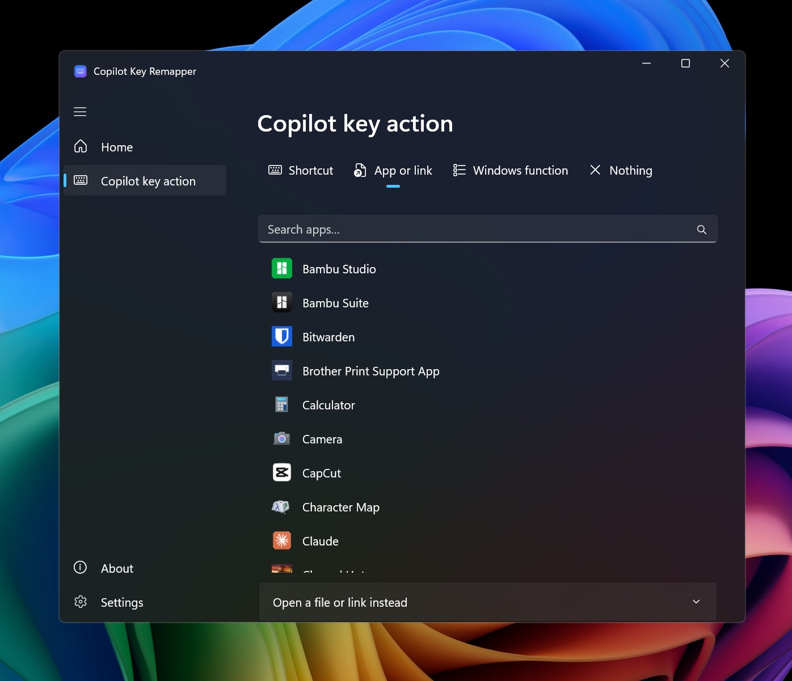
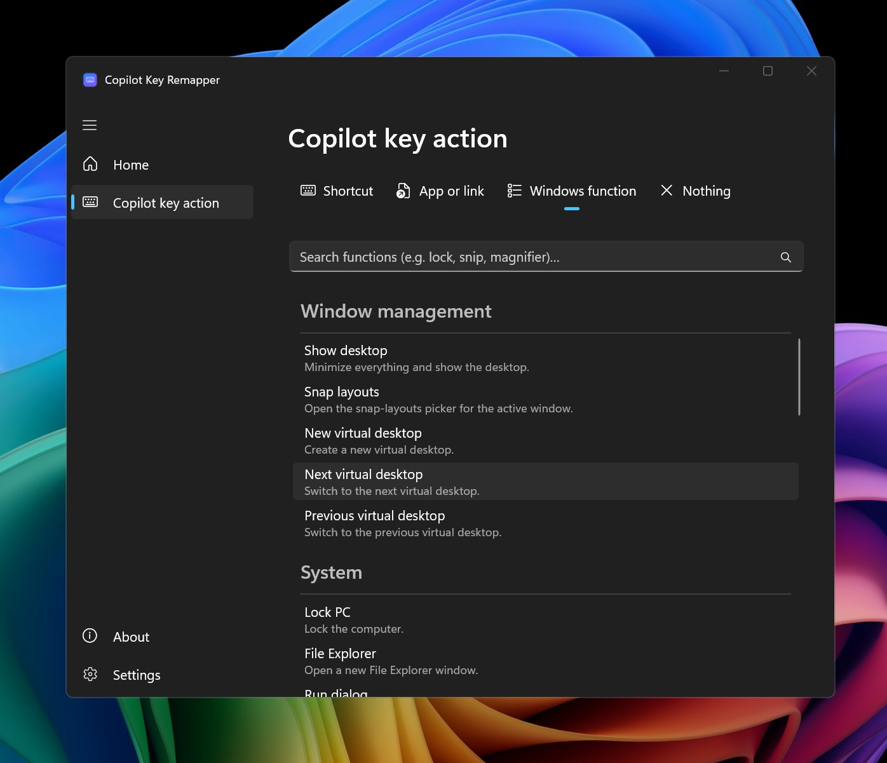

  

<h1 align="center">Repilot</h1>

  Remap the Windows 11 Copilot key to do what <em>you</em> want — a keyboard shortcut, an app or link, or a built-in Windows function.

  

  
  &nbsp;
  
  &nbsp;
  

Repilot lets you choose what your keyboard's dedicated **Copilot key** (or **Windows logo key + C**) does, using the official Microsoft "Copilot hardware key provider" path — so it appears right in **Settings → Bluetooth & devices → Keyboard → Customize Copilot key**.

**No background service. No wasted resources.** Nothing runs while you wait for the
key — there's no always-on service, no tray icon, and no startup task sitting in
memory or burning CPU/battery. When you press the key, a tiny handler runs your action
in a fraction of a second and exits. The settings app only runs while you have it open.
Idle footprint: zero.

## What the key can do

1. **A custom shortcut**: record any chord, including system ones like Alt+Tab.
2. **Text**: type a character such as ç, or a short phrase, regardless of your keyboard layout.
3. **An app, file, or link**: pick from a searchable list of installed apps, or enter any path or URL.
4. **A Windows function**: choose from a curated, searchable catalog (Task View, snap, lock, Snip & Sketch, Magnifier, and more).
5. **Nothing**: quietly disable the key.

The settings app follows your Windows display language, or you can choose one in Settings: English (United States or Canada), Spanish, French (France or Canada), German, Simplified Chinese, Brazilian Portuguese, or Japanese. Translations are machine-generated.

## Installing

1. Get Repilot from the **[Microsoft Store](https://apps.microsoft.com/detail/9pb5fj08pnvj)** — it installs and stays up to date automatically.
2. Go to **Settings → Bluetooth & devices → Keyboard → Customize Copilot key → Custom → Repilot**.
3. Open **Repilot** from the Start menu to choose what the key does. You can also check for updates from the About page.

> You'll see **two Start entries** — **Repilot** (the settings app) and **Repilot Key**
> (which runs your assigned action). Both are expected: Windows only lets you pick
> *visible* apps for the Copilot key, so the key handler needs its own entry.

## Requirements

- Windows 11 (build 22000 or newer), with a Copilot key — or use **Windows logo key + C**.

## Building from source

Repilot is open source. See **[DEVELOPING.md](DEVELOPING.md)** for the architecture and build instructions.

Releases here carry **release notes only**, with nothing attached to download. Repilot has to
be an installed, signed MSIX before Windows will let the Copilot key be assigned to it, so an
unpackaged build is not something you could use. The
[Microsoft Store](https://apps.microsoft.com/detail/9pb5fj08pnvj) is the install route, and
building it yourself is the alternative.

## License

Licensed under the [PolyForm Noncommercial License 1.0.0](LICENSE.md): free for any
**personal and other noncommercial use**, including modifying and redistributing it.
**Commercial use is not permitted.** Copyright © 2026 Ryan Ewen.
