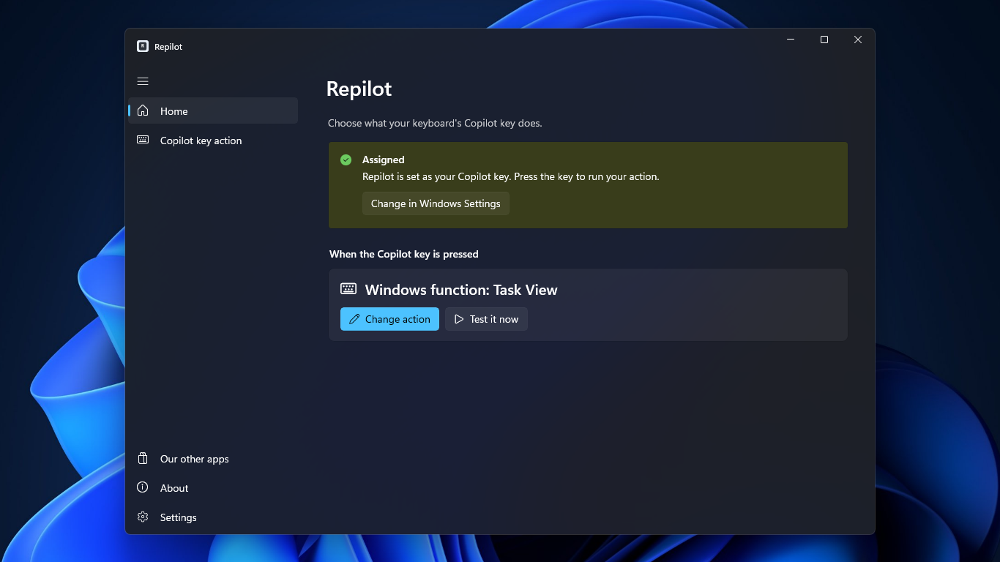
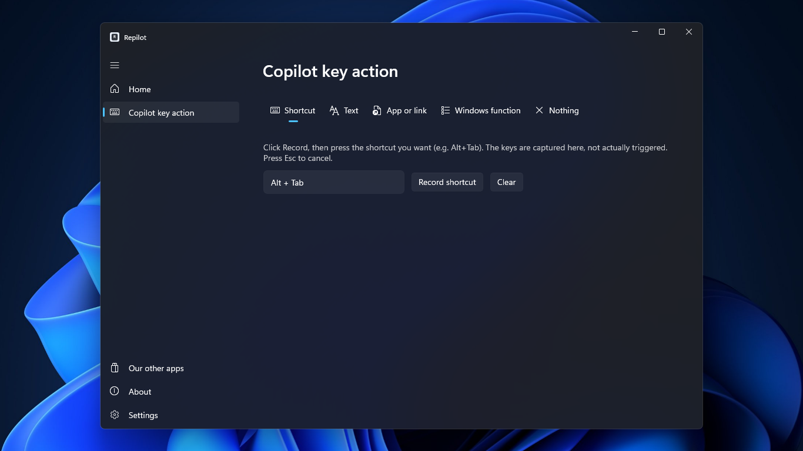
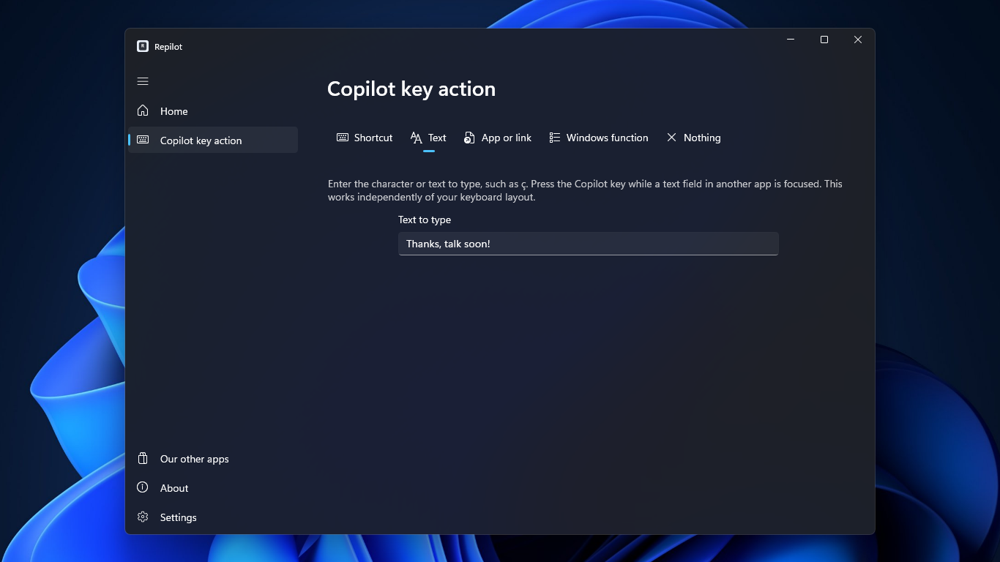

  

<h1 align="center">Repilot</h1>

  Remap the Windows 11 Copilot key to do what <em>you</em> want: a keyboard shortcut, text, an app or link, or a built-in Windows function.

  

  
  &nbsp;
  
  &nbsp;
  

Repilot lets you choose what your keyboard's dedicated **Copilot key** (or **Windows logo key + C**) does. It uses Windows' own Copilot key setting, so you turn it on in **Settings > Bluetooth & devices > Keyboard > Customize Copilot key**.

## Features

- **Keyboard shortcut:** record any combination, including system ones like Alt+Tab.
- **Text:** type a character such as ç, or a short phrase, whatever your keyboard layout.
- **App, file or link:** pick from a searchable list of installed apps, or enter any path or URL.
- **Windows function:** choose from a searchable list (Task View, snap layouts, Lock PC, screen snip, Magnifier and more).
- **Nothing:** switch the key off so a stray press does nothing.
- **Nothing running in the background:** no service, tray icon or startup task. Press the key and a tiny handler runs your action, then exits.

## Get it

1. Get Repilot from the **[Microsoft Store](https://apps.microsoft.com/detail/9pb5fj08pnvj)**. It installs and stays up to date automatically. US$0.99, with a free trial.
2. Go to **Settings > Bluetooth & devices > Keyboard > Customize Copilot key > Custom > Repilot**.
3. Open **Repilot** from the Start menu to choose what the key does. You can also check for updates from the About page.

Repilot adds **two entries** to Start: **Repilot**, where you choose the action, and **Repilot Key**, which Windows runs when you press the key.

Repilot collects no telemetry or crash reports.

### Requirements

- Windows 11. Works with a Copilot key or with **Windows logo key + C**.

## Languages

Available in English, Spanish, French, German, Simplified Chinese, Brazilian Portuguese and Japanese. Repilot follows Windows' display language unless you pick one in Settings. Translations are machine-generated.

## Developers

- [Development guide](docs/development.md): architecture, building, Store publishing, and where the app stores data.
- [Agent instructions](AGENTS.md): behavior rules and conventions.
- [Releases](https://github.com/Dynamic-Solutions-Canada/repilot/releases): what changed in each version. Repilot installs from the Microsoft Store, or you can build it yourself.

## License

Copyright (c) 2026 Dynamic Solutions. Licensed under the [PolyForm Noncommercial License 1.0.0](LICENSE), free for personal and other noncommercial use.
