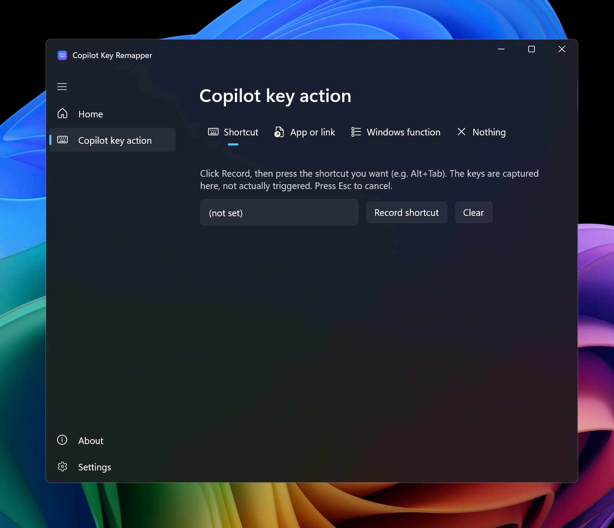

  

<h1 align="center">Repilot</h1>

  Remap the Windows 11 Copilot key to do what <em>you</em> want: a keyboard shortcut, text, an app or link, or a built-in Windows function.

  

  
  &nbsp;
  
  &nbsp;
  

Repilot lets you choose what your keyboard's dedicated **Copilot key** (or **Windows logo key + C**) does. It uses Microsoft's official "Copilot hardware key provider" support, so it appears right in **Settings > Bluetooth & devices > Keyboard > Customize Copilot key**.

## Features

- **A custom shortcut:** record any chord, including system ones like Alt+Tab.
- **Text:** type a character such as ç, or a short phrase, regardless of your keyboard layout.
- **An app, file, or link:** pick from a searchable list of installed apps, or enter any path or URL.
- **A Windows function:** choose from a curated, searchable catalog (Task View, snap, lock, Snip & Sketch, Magnifier, and more).
- **Nothing:** quietly disable the key.
- **No background service:** nothing runs while you wait for the key. There is no always-on service, no tray icon and no startup task using memory, CPU or battery. When you press the key, a tiny handler runs your action in a fraction of a second and exits, and the settings app only runs while you have it open.

## Get it

1. Get Repilot from the **[Microsoft Store](https://apps.microsoft.com/detail/9pb5fj08pnvj)**. It installs and stays up to date automatically.
2. Go to **Settings > Bluetooth & devices > Keyboard > Customize Copilot key > Custom > Repilot**.
3. Open **Repilot** from the Start menu to choose what the key does. You can also check for updates from the About page.

You'll see **two Start entries**: **Repilot** (the settings app) and **Repilot Key** (which runs your assigned action). Both are expected: Windows only lets you pick *visible* apps for the Copilot key, so the key handler needs its own entry.

Repilot collects no telemetry or crash reports.

### Requirements

- Windows 11 (build 22000 or newer), with a Copilot key, or use **Windows logo key + C**.

## Languages

Repilot is available in English (United States and Canada), Spanish, French (France and Canada), German, Simplified Chinese, Brazilian Portuguese and Japanese. It follows Windows' display language unless you pick one in Settings. Translations are machine-generated.

## Developers

- [Development guide](docs/development.md): architecture, building, Store publishing, and where the app stores data.
- [Agent instructions](AGENTS.md): behaviour rules and conventions.

Releases on GitHub carry release notes only, with nothing to download. Repilot has to be an installed, signed MSIX before Windows will let the Copilot key be assigned to it, so the [Microsoft Store](https://apps.microsoft.com/detail/9pb5fj08pnvj) is the install route, and building it yourself is the alternative.

## License

Licensed under the [PolyForm Noncommercial License 1.0.0](LICENSE): free for any **personal and other noncommercial use**, including modifying and redistributing it. **Commercial use is not permitted.** Copyright (c) 2026 Dynamic Solutions.
